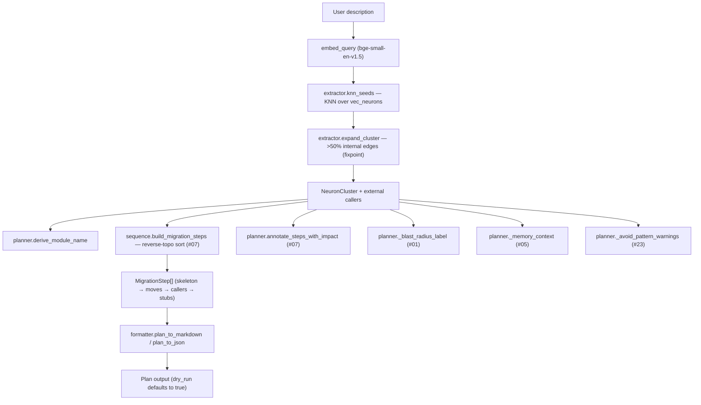
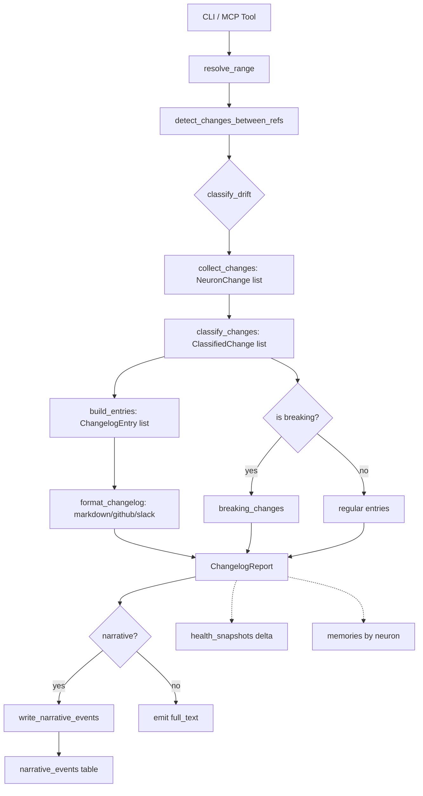

# Cerebrofy — Architecture Guide

This document describes the internal structure, data flow, key invariants, and extension points of Cerebrofy. It is aimed at contributors and anyone who wants to understand how the system works beneath the CLI.

---

## Module Map

```
src/cerebrofy/
├── cli.py                        ← Click command group — registers all sub-commands
│
├── commands/
│   ├── init.py                   ← cerebrofy init: scaffold, hooks, MCP registration
│   ├── build.py                  ← cerebrofy build: 6-step atomic pipeline
│   ├── update.py                 ← cerebrofy update: partial atomic re-index
│   ├── validate.py               ← cerebrofy validate: drift classification
│   ├── arch.py                   ← cerebrofy arch: check/explain/history/init/watch
│   ├── migrate.py                ← cerebrofy migrate: sequential schema migrations
│   ├── mcp.py                    ← cerebrofy mcp: MCP stdio server entry point
│   ├── session.py                ← cerebrofy session: list/show/diff/search/export replays
│   ├── plan.py                   ← cerebrofy plan: graph-aware refactor plan (Idea #12)
│   ├── upgrade.py                ← cerebrofy upgrade: dependency upgrade navigator (Idea #19)
│   ├── governance.py             ← cerebrofy governance: ownership, CODEOWNERS, reviewers (Idea #18)
│   └── review.py                 ← cerebrofy review: graph-aware review copilot (Idea #17)
│
├── parser/
│   ├── engine.py                 ← Tree-sitter runner; dispatches to .scm queries
│   └── neuron.py                 ← Neuron dataclass + ParseResult + deduplicate_neurons
│
├── graph/
│   ├── edges.py                  ← Edge dataclass + rel_type constants
│   └── resolver.py               ← Two-pass name lookup: local + cross-module edges
│
├── embedder/
│   ├── base.py                   ← Embedder ABC: embed(texts) -> list[list[float]]
│   └── local.py                  ← LocalEmbedder (fastembed BAAI/bge-small-en-v1.5, batch 64)
│
├── db/
│   ├── connection.py             ← open_db(): load sqlite-vec + WAL; check_schema_version()
│   ├── schema.py                 ← DDL constants (CREATE TABLE / INDEX / VIRTUAL TABLE)
│   ├── writer.py                 ← write_nodes(), write_edges(), upsert_vectors(), etc.
│   └── lock.py                   ← BuildLock: PID file acquire/release/stale-check
│
├── search/
│   └── hybrid.py                 ← hybrid_search(): KNN + BFS, single read-only connection
│
├── markdown/
│   ├── lobe.py                   ← write_lobe_md(): per-lobe Markdown summary
│   └── map.py                    ← write_map_md(): cerebrofy_map.md
│
├── hooks/
│   └── installer.py              ← install_hooks(), upgrade_hook(), add_gitignore_entry()
│
├── arch/
│   ├── rules.py                  ← Arch rule DSL: parse/validate .cerebrofy/arch-rules.yaml
│   ├── checker.py                ← Rule evaluation engine: graph queries → violations
│   ├── reporter.py               ← Reports: text / markdown / json / GitHub annotations
│   ├── watcher.py                ← cerebrofy arch watch: live monitor + Slack notifications
│   ├── history.py                ← arch-history.jsonl: when each rule was first violated
│   ├── memory.py                 ← arch check --write-memories: violation → warning memory
│   └── ci.py                     ← CI workflow template (init --ai / arch init --ci)
│
├── ignore/
│   └── ruleset.py                ← IgnoreRuleSet (pathspec, gitignore dialect)
│
├── mcp/
│   ├── registrar.py              ← MCP config path detection + idempotent write
│   ├── server.py                 ← MCPServer: tool + resource dispatch (36 tools)
│   ├── tools/upgrade.py          ← cerebrofy_upgrade handler: plan / auto-fix / validate
│   ├── tools/governance.py       ← cerebrofy_governance handler: CODEOWNERS / reviewers / rules
│   ├── tools/review.py           ← cerebrofy_review handler: diff/PR review
│   └── tools/coordination.py     ← cerebrofy_claim / release / who / conflicts / resolve handlers
│
├── session/                      ← (Idea #11) Live Agent Session Recorder
│   ├── recorder.py               ← sessions + session_events storage; blast-radius tracking
│   ├── replay.py                 ← build_session_diff() — graph delta + risk verdict
│   ├── reporter.py               ← render_markdown() + render_html() replay renderers
│   └── middleware.py             ← SessionMiddleware: thin recorder wired into the MCP dispatcher
├── coordination/                 ← (Idea #25) Multi-Agent Coordination
│   ├── registry.py               ← active_agents storage: claims, heartbeats, stale cleanup
│   ├── conflict_detector.py      ← claim collisions, lobe awareness, keyword-opposition memories
│   ├── resolver.py               ← keep_newest / keep_by_author / human_review / merge
│   └── constants.py              ← TTL bounds, heartbeat interval, resolution strategies
├── planning/                     ← Refactor Planner (Idea #12)
    ├── extractor.py              ← KNN seed + cohesive cluster expansion (>50% internal edges)
    ├── sequence.py               ← dependency-safe migration steps (reverse-topo sort)
    ├── formatter.py              ← Markdown + JSON plan output
    └── planner.py                ← pipeline orchestration + feature integrations
├── changelog/                    ← Semantic Changelog Generator (Idea #14)
    ├── classifier.py             ← drift records + blast radius + memories → entry types
    ├── generator.py              ← audience-specific text (developer/pm/user)
    ├── formatter.py              ← markdown | github | slack output
    └── __init__.py               ← public API surface
├── config/
│   └── loader.py                 ← CerebrофyConfig dataclass + YAML I/O
│
├── update/
│   ├── change_detector.py        ← ChangeSet via git diff or hash comparison
│   └── scope_resolver.py         ← UpdateScope via depth-2 BFS from changed nodes
│
├── upgrade/                      ← (Idea #19) Offline Dependency Upgrade Navigator
│   ├── manifest.py               ← curated YAML/JSON manifests + version matching
│   ├── scanner.py                ← indexed imports/APIs → per-change UsageSite list
│   ├── planner.py                ← dependency-ordered steps, effort, risk, Markdown/JSON
│   ├── fixer.py                  ← line-scoped AST transforms with re-parse safety
│   ├── validator.py              ← post-upgrade rescan → PASS/FAIL + remaining sites
│   └── manifests/                ← bundled pydantic v1→v2 and requests 2→3 manifests
│
├── governance/                   ← (Idea #18) Lobe Ownership & Governance
│   ├── ownership.py              ← blame/explicit/hybrid ownership + bus factor
│   ├── codeowners.py             ← dynamic CODEOWNERS generation
│   ├── rules.py                  ← governance.rules evaluation
│   └── reviewer.py               ← primary/secondary/backup reviewer suggestions
│
├── review/                       ← (Idea #17) AI Review Copilot
│   ├── finding.py                ← finding model/severity + rendering
│   ├── pipeline.py               ← diff/PR resolution + seven graph checks
│   └── github_poster.py          ← opt-in PR comment posting
│
├── skills/
│   ├── installer.py              ← install_skills() + install_instructions()
│   └── templates/                ← Bundled SKILL.md + slash-command templates per AI client
│
├── validate/
│   └── drift_classifier.py       ← DriftRecord: hash scan → re-parse → Neuron diff
│
└── changelog/
    ├── classifier.py               ← Changes → semantic entry types (breaking-first)
    ├── generator.py                ← Classified changes → ChangelogReport + narrative events
    ├── formatter.py                ← Markdown / GitHub / Slack output formatters
    └── __init__.py                 ← Public API: collect_changes, generate_changelog, etc.
```

---

## Data Flow

### `cerebrofy build`

```
config.yaml + .cerebrofy-ignore
        │
        ▼
   parse_directory()              ← Tree-sitter + .scm queries → list[ParseResult]
        │
        ▼
   write_nodes(conn, neurons)     ← INSERT into nodes table
        │
        ├── resolve_local_edges() → LOCAL_CALL edges
        └── resolve_cross_module_edges() + resolve_import_edges()
                                  → EXTERNAL_CALL, IMPORT, RUNTIME_BOUNDARY edges
        │
        ▼
   write_edges(conn, edges)       ← INSERT into edges table
        │
        ▼
   embedder.embed(texts)          ← list[Neuron] → list[list[float]]
        │
        ▼
   upsert_vectors(conn, ...)      ← INSERT into vec_neurons (sqlite-vec)
        │
        ▼
   build_step5_commit()           ← compute state_hash, write file_hashes, conn.commit()
        │
        ▼
   os.replace(.tmp → .db)         ← ATOMIC SWAP (only on full success)
        │
        ▼
   write_lobe_md() × N            ← per-lobe Markdown (post-swap, fresh conn)
   write_map_md()                 ← cerebrofy_map.md
```

---

## Database Schema

Single file: `.cerebrofy/db/cerebrofy.db`

```sql
-- Named code units (functions, classes, modules)
CREATE TABLE nodes (
  id          TEXT PRIMARY KEY,   -- "{file}::{name}"
  name        TEXT NOT NULL,
  file        TEXT NOT NULL,      -- path relative to repo root
  type        TEXT,               -- "function" | "class" | "module"
  line_start  INTEGER,
  line_end    INTEGER,
  signature   TEXT,
  docstring   TEXT,
  hash        TEXT                -- SHA-256 of the source span
);
CREATE INDEX idx_nodes_file ON nodes(file);
CREATE INDEX idx_nodes_name ON nodes(name);

-- Typed call/import edges between Neurons
CREATE TABLE edges (
  src_id    TEXT REFERENCES nodes(id),
  dst_id    TEXT,
  rel_type  TEXT NOT NULL,        -- LOCAL_CALL | EXTERNAL_CALL | IMPORT | RUNTIME_BOUNDARY
  file      TEXT,
  PRIMARY KEY (src_id, dst_id, rel_type)
);
CREATE INDEX idx_edges_src ON edges(src_id);
CREATE INDEX idx_edges_dst ON edges(dst_id);

-- Key-value metadata
CREATE TABLE meta (
  key    TEXT PRIMARY KEY,
  value  TEXT
);
-- Keys: schema_version, embed_model, embed_dim, state_hash, last_build

-- Per-file content hashes (for drift detection)
CREATE TABLE file_hashes (
  file  TEXT PRIMARY KEY,
  hash  TEXT NOT NULL             -- SHA-256 of file content at last build/update
);

-- Multi-agent coordination registry (Idea #25). Ephemeral: the table lives in
-- cerebrofy.db and is discarded when `cerebrofy build` recreates the database.
CREATE TABLE active_agents (
  agent_id        TEXT PRIMARY KEY,
  agent_type      TEXT NOT NULL,
  session_id      TEXT,                          -- not an FK yet (Idea #11 TODO)
  intent          TEXT,
  claimed_neurons TEXT NOT NULL DEFAULT '[]',   -- JSON array of neuron ids
  started_ts      INTEGER NOT NULL,
  last_heartbeat  INTEGER NOT NULL,
  status          TEXT DEFAULT 'active',         -- 'active' | 'completed'
  ttl_minutes     INTEGER NOT NULL DEFAULT 60,   -- 1..1440
  expires_ts      INTEGER,                       -- TTL deadline (refreshed by heartbeat)
  created_ts      INTEGER NOT NULL
);

-- sqlite-vec virtual table for KNN search (384-dim for BAAI/bge-small-en-v1.5)
CREATE VIRTUAL TABLE vec_neurons USING vec0(
  id          TEXT PRIMARY KEY,
  embedding   FLOAT[384]
);
```

Every `nodes` row has a corresponding `vec_neurons` row after a completed build (Law III). The `vec_neurons` table cannot be updated in-place — `cerebrofy update` always DELETE+INSERT within the same transaction.

---

## Key Invariants

These rules are architectural constraints. No PR may violate them.

| # | Invariant |
|---|-----------|
| I | `cerebrofy init` MUST NOT create `cerebrofy.db`. The database is created exclusively by `cerebrofy build`. |
| II | All call edges are stored in the `edges` table. `RUNTIME_BOUNDARY` edges are stored but NEVER traversed in BFS. They are collected as `RuntimeBoundaryWarning` items and returned separately. |
| III | Every Neuron in `nodes` MUST have a corresponding row in `vec_neurons` after a completed build. |
| IV | Git hooks start warn-only (v1). Hard-block (v2) activates only after `cerebrofy update` is verified to run in < 2s. |
| V | Zero language-specific logic in `parser/engine.py` or `graph/resolver.py`. All language rules live in `.scm` files. |
| — | `cerebrofy build` writes to `cerebrofy.db.tmp`; swaps via `os.replace()` on success only. |
| — | `cerebrofy update` wraps all DML in `BEGIN IMMEDIATE`. `vec0` does not support UPDATE — always DELETE+INSERT within same transaction. |
| — | Read-only commands (`search/hybrid.py`) open with `?mode=ro` URI and load sqlite-vec manually. |

---

## The Neuron

The `Neuron` is the fundamental unit of the Cerebrofy index:

```python
@dataclass(frozen=True)
class Neuron:
    id: str           # "{file}::{name}" — globally unique
    name: str         # function/class/module name
    type: str         # "function" | "class" | "module"
    file: str         # relative path from repo root
    line_start: int   # 1-based
    line_end: int     # 1-based, inclusive
    signature: str | None
    docstring: str | None
```

Neurons are **immutable value objects** (`frozen=True`). Within a single file, if the same `id` appears more than once, only the first occurrence by `line_start` is kept (`deduplicate_neurons()`). Anonymous functions (lambdas, arrow functions) are never captured.

---

## Edge Types

| Type | Meaning |
|------|---------|
| `LOCAL_CALL` | Function call resolved within the same file |
| `EXTERNAL_CALL` | Function call resolved to another file via the name registry |
| `IMPORT` | Import statement resolved to the imported module's Neurons |
| `RUNTIME_BOUNDARY` | Unresolvable cross-language or dynamic call — stored but never traversed in BFS |

`RUNTIME_BOUNDARY` edges are collected as `RuntimeBoundaryWarning` objects during hybrid search and returned separately — they are never included in blast-radius counts.

---

## Hybrid Search

`hybrid_search()` in `search/hybrid.py` combines two strategies over a single read-only SQLite connection:

1. **KNN search** — `vec_neurons` cosine similarity query via `vec_f32() MATCH`, returns `top_k` `MatchedNeuron` objects ordered by similarity descending
2. **BFS expansion** — depth-2 BFS from each matched Neuron, collecting `MatchedNeuron` objects for each structural neighbor (excludes `RUNTIME_BOUNDARY` edges)
3. **Lobe resolution** — derives affected lobe names by matching file paths against `config.lobes`

```
similarity = max(0.0, 1.0 - cosine_distance)
```

The connection is opened with `?mode=ro` (read-only). sqlite-vec is loaded manually on the connection — `open_db()` is not used here because it sets WAL pragma, which is incompatible with `?mode=ro`.

**Public API:**

```python
embedding = embed_query(query, config.embedding_model)   # embed BEFORE opening DB
result = hybrid_search(
    query=query,
    db_path=db_path,
    embedding=embedding,
    top_k=10,
    lobes=config.lobes,
    repo_root=root,
)
# result.matched_neurons  — KNN hits, sorted by similarity desc
# result.blast_radius     — BFS neighbors (similarity = 0.0)
# result.runtime_boundary_warnings — RUNTIME_BOUNDARY edges encountered
# result.affected_lobes   — sorted lobe names from all neurons
```

---

## Refactor Planner (Idea #12)

`cerebrofy plan` turns a plain-English refactoring description into a graph-aware, dependency-safe migration plan. The planner is a pure planning layer — it reads the index and emits a plan; it **never writes source files**. Execution is an explicit handoff (`--execute`) to an AI agent, verified per-step with `cerebrofy impact`.

**Pipeline:** `extractor` → `sequence` → `formatter`.



**Modules** (`src/cerebrofy/planning/`):

| Module | Responsibility |
|--------|---------------|
| `extractor.py` | KNN seed reused from `search/hybrid.py` + fixpoint cluster expansion (neighbors with >50% internal edges join). `RUNTIME_BOUNDARY` edges are never traversed (Law II). |
| `sequence.py` | Dependency-safe migration ordering, reusing the reverse-topological sort from `analysis/sequence.py` (#07). Every neuron appears in at most one step — ordering can never be circular. |
| `formatter.py` | Emits the exact spec JSON schema (`cluster`, `proposed_structure`, `callers_to_update`, `steps`, `estimated_hours`, `files_affected`) plus a human-reviewable Markdown checklist. |
| `planner.py` | Orchestrates the pipeline and wires integrations: #01 blast radius (risk label), #05 agent memory (plan context), #07 impact (per-step prediction), #23 product intent (`avoid_patterns`). Each degrades gracefully when its data is absent. |

**Entry points:** `commands/plan.py` (`cerebrofy plan`) and `mcp/tools/plan.py` (`cerebrofy_plan`), registered additively in `cli.py` and `mcp/server.py`.

**Integrations deferred to later ideas** (marked with `TODO(integration-N)`, not wired on this branch):
- #11 — record plan execution as a session
- #17 — post-execution review copilot
- #24 — synthesized-pattern avoidance for historically-failing steps

**Acceptance targets:** plan generation < 10s; sequencing never circular; caller-update list complete (asserted by deterministic fixture-graph unit tests).

---

## Git Hook Lifecycle

```
cerebrofy init
    └── install pre-push hook (version 1, warn-only)
            # BEGIN cerebrofy
            # cerebrofy-hook-version: 1
            cerebrofy validate --hook pre-push
            # END cerebrofy

cerebrofy update  (completes in < 2s)
    └── upgrade_hook() → version 2 (hard-block, idempotent)
            # BEGIN cerebrofy
            # cerebrofy-hook-version: 2
            if ! cerebrofy validate --hook pre-push; then
                echo 'Cerebrofy: Structural drift detected. Run cerebrofy update to sync.'
                exit 1
            fi
            # END cerebrofy

.cerebrofy/arch-rules.yaml exists  (scaffolded by init, extended by arch init)
    └── upgrade_hook() → version 4 (validate section + blocking arch section)
            # BEGIN cerebrofy
            # cerebrofy-hook-version: 4
            <validate section: warn-only or hard-block, per .cerebrofy/ gitignore state>
            if [ -f ".cerebrofy/arch-rules.yaml" ]; then
                if ! cerebrofy arch check --hook pre-push; then
                    echo 'Cerebrofy: Architecture violations detected. Push blocked.' >&2
                    exit 1
                fi
            fi
            # END cerebrofy
```

The sentinel format `# BEGIN cerebrofy` / `# cerebrofy-hook-version: N` / `# END cerebrofy` allows `upgrade_hook()` to locate and replace exactly the Cerebrofy block without disturbing any pre-existing hook logic. v4 is upgrade-only and always hard-blocks on architecture violations — the gitignore consent model applies to the validate section only. Removing the rules file disarms the arch segment at runtime; it never downgrades an installed hook.

---

## MCP Dispatcher

The MCP server (`mcp/server.py`) uses **CWD routing**: at each tool invocation it calls `os.getcwd()` and walks up the directory tree looking for `.cerebrofy/config.yaml`. A single registered MCP server entry (`mcpServers.cerebrofy`) serves all repos on the machine — no per-repo registration needed.

**Launch boundary (C1).** Per-call routing is clipped to a *launch boundary* set once at start-up (`utils/paths.py::set_root_boundary`): when the server is launched inside a Cerebrofy project the boundary is that project root, so a manipulated CWD cannot redirect the server at a sibling project; when it is launched at a non-project directory (for example a workspace root holding several repos) the boundary is the launch CWD itself, so the repos *beneath* it are still served while siblings and parents are not. `--root` / `CEREBROFY_ROOT` remain a hard pin — the walk-up is skipped entirely and the boundary does not apply.

```
AI calls search_code(query="rate limiting middleware")
    │
    ▼
run_mcp_server() → call_tool("search_code", {"query": "..."})
    │
    ▼
_find_repo_root(Path.cwd())       ← reads CWD at call time
    │
    ▼
load_config(root / ".cerebrofy/config.yaml")
    │
    ▼
embed_query(query, config.embedding_model)
    │
    ▼
hybrid_search(query, db_path, embedding, ...)
    │
    ▼
returns TextContent(type="text", text=<json ranked results>)
```

---

## Session Recorder (Idea #11)

The **Live Agent Session Recorder** captures every MCP tool call of an agent session as a structured, local-only replay: which neurons were touched, in what order, what changed in the call graph, and how the blast radius (Idea #01) moved. Recording is **opt-in** (`record_sessions: true` in `.cerebrofy/config.yaml`) and **zero-impact** on tools that run without it.

Storage is split from the index for the same reason `memories.db` (#05) is split from `cerebrofy.db`: the index is rebuilt atomically by `cerebrofy build` and written under `BEGIN IMMEDIATE` by `cerebrofy update`, while the audit trail must survive rebuilds and never contend with the index writer.

- `session/recorder.py` — `sessions` + `session_events` tables in `.cerefy/db/sessions.db`; `start_session`, `record_event`, `end_session`, `search_sessions`. Argument/result payloads are truncated so storage stays well under 1 MB/hour.
- `session/middleware.py` — thin `SessionMiddleware` with per-request instances (no global singleton); recording only fires when opt-in is enabled and a session is active, and never raises.
- `session/replay.py` — `build_session_diff()` computes the graph delta (touched / missing / appeared / index-refreshed) and a blast-radius verdict.
- `session/reporter.py` — self-contained Markdown + HTML renderers for `cerebrofy session show/export`.
- `mcp/tools/session.py` — `cerebrofy_session_start` / `cerebrofy_session_end` / `cerebrofy_session_show` handlers.

### Recording flow

```mermaid
flowchart TD
    A[AI agent starts a coding task] --> B{record_sessions<br/>enabled in config?}
    B -- yes --> C[cerebrofy_session_start&#40;task, agent&#41;<br/>INSERT sessions row → sess_id]
    B -- no --> D[tools run normally<br/>no recording]
    C --> E[MCP dispatcher wraps every tool call<br/>call_tool → SessionMiddleware.record]
    E --> F[record_event&#40;sessions.db&#41;<br/>args/result truncated < 1KB]
    F --> G[resolve_neuron_refs&#40;&#41; + depth-2<br/>blast-radius lookup into cerebrofy.db<br/>captured once per neuron]
    G --> E
    E --> H[cerebrofy_session_end&#40;outcome, summary&#41;<br/>ends session + blast_radius_after + outcome]
    H --> I[sessions.db: closed session]
    I --> J[cerebrofy session show/show/diff/export<br/>replay_session + build_session_diff<br/>+ render_markdown&#40;&#41; / render_html&#40;&#41;]
    style D fill:#f6f8fa,stroke:#e1e4e8
    style J fill:#f6f8fa,stroke:#e1e4e8
```



The `SessionMiddleware.record()` path is bounded for latency: one indexed `INSERT` per tool call plus a single depth-2 blast-radius lookup per *new* neuron referenced (capped at `MAX_TRACKED_NEURONS = 50`). The `cerebrofy_session_start/end/show` tools are deliberately excluded from recording so they never appear nested inside their own session.

### Database layout

`cerebrofy.db` (schema version 1, rebuilt by `cerebrofy build`) and `sessions.db` / `memories.db` are peer local databases under `.cerebrofy/db/`. Session recording reads `cerebrofy.db` in read-only mode (`?mode=ro`) for blast-radius lookups and writes only to `sessions.db`.

---

## Multi-Agent Coordination (Idea #25)

Coordination lets several agents — and humans — share one codebase without
silently undoing each other's work. It is a local, advisory protocol: Cerebrofy
reports claim collisions and contradicting memories, but never blocks an edit.

- `coordination/registry.py` — persistent `active_agents` rows in
  `.cerebrofy/db/cerebrofy.db`. `claim_neurons`, `release_neurons`, `release_all`,
  `heartbeat`, and `cleanup_stale_agents` are the only writers.
- `coordination/conflict_detector.py` — claim collisions, same-lobe awareness,
  and the Phase-1 keyword-opposition heuristic for memories (`keyword_opposition`).
- `coordination/resolver.py` — `keep_newest`, `keep_by_author`, `human_review`,
  and `merge` against `memories.db`; mutations are atomic and surface-neutral
  (`winner` / `loser` / `superseded`).
- `mcp/tools/coordination.py` — `cerebrofy_claim`, `cerebrofy_release`,
  `cerebrofy_who`, `cerebrofy_conflicts`, `cerebrofy_resolve`.
- `commands/coordination.py` — the matching `cerebrofy who|claim|release|conflicts|resolve`
  commands plus the `cerebrofy coordination` alias group.

### Heartbeats, TTL, and stale claims

Any MCP tool call that identifies an agent is a heartbeat: `search_code`,
`get_neuron`, and `cerebrofy_remember` accept an optional `agent_id`, and the
dispatcher also falls back to `CEREBROFY_AGENT_ID`. A heartbeat refreshes
`last_heartbeat` and pushes `expires_ts` forward by the claim's TTL.

- Heartbeat interval: **5 minutes**.
- Stale threshold: **2× the interval (10 minutes) or the TTL**, whichever comes
  first. Stale rows are marked `completed` and their claims are cleared.
- TTL: default **60 minutes**, configurable per claim in `1..1440` minutes
  (`ttl_minutes` / `--ttl-minutes`).

### `active_agents` storage

The table has 11 columns: `agent_id`, `agent_type`, `session_id`, `intent`,
`claimed_neurons`, `started_ts`, `last_heartbeat`, `status`, `ttl_minutes`,
`expires_ts`, `created_ts`. `status` is only `active` or `completed`.
`session_id` records the Idea #11 session id supplied with a
claim but is **not a foreign key**; adding that constraint is an Idea #11 TODO.
The full per-column contract lives in [docs/coordination.md](coordination.md) and
[docs/db-schema.md](db-schema.md).

### Read-only reads

`cerebrofy_who`, `cerebrofy_conflicts`, and the heartbeat/conflict hooks open the
registry **read-only** and never create `cerebrofy.db`; if the index is absent
they return `NO_INDEX` (or silently skip the optional notice) instead of creating
state. Only explicit claim/release/heartbeat calls mutate `active_agents`, and all
of those go through `write_transaction`.

### Ephemeral on rebuild

Coordination state is deliberately **ephemeral**: it lives in `cerebrofy.db`,
which `cerebrofy build` recreates atomically. A full rebuild therefore discards
every claim and registration — re-claim after rebuilding. Durable knowledge
belongs in `memories.db`.

---

## Semantic Changelog (#14)

The changelog pipeline classifies changes from the **semantic graph** — not commit messages — and renders them as audience-specific entries. It is exposed via the `cerebrofy changelog` CLI command and the `cerebrofy_changelog` MCP tool.

### Flow

```
cerebrofy changelog --since <ref> --audience <dev|pm|user> --format <md|gh|slack>
    │
    ▼
resolve_range()              ← git tag/hash ↔ commit hash (or last-build, project-start)
    │                          raises ChangelogError(REF_NOT_FOUND) if the ref is missing
    ▼
detect_changes_between_refs() ← git diff --name-status since_ref..until_ref
    │
    ├── DriftRecord per file from classify_drift(drift_classifier.py)
    │       reads: nodes.name, nodes.signature, nodes.type, file_hashes
    │       returns: neuron-level change kind (added/removed/signature_changed)
    │
    ▼
collect_changes()            ← NeuronChange list (file, name, lobe, kind)
    │
    ▼
classify_changes()           ← breaking-first precedence:
│                                 added → breaking → security → perf → fix → internal
│                               refactor for cross-lobe moves
│                               is_breaking_change(): removed w/ callers, sig change on
│                               public surface, >BREAKING_CROSS_LOBE_CALLERS cross-lobe
│
▼
build_entries()              ← ordered ChangelogEntry list per audience
    │                          (pm/user: internal & intent_update text suppressed)
    ▼
format_changelog()           ← markdown | github | slack
    │
    ▼
ChangelogReport.to_dict()    ← exact spec schema:
                              {since, until, entries[], breaking_changes[],
                               health_delta, full_text}
```

### Classification matrix

| Entry type | Trigger |
|---|---|
| `feat` | New neuron (no predecessor in index) |
| `fix` | Existing neuron modified + warning memory |
| `refactor` | Same name removed from one lobe, added in another |
| `security` | Security/CVE-tagged memories on a changed neuron |
| `breaking` | Removal with callers · signature change on public surface · >3 cross-lobe callers |
| `perf` | Performance-tagged memories on a changed neuron |
| `internal` | No other signal matched |
| `intent_update` | `.cerebrofy/intent.yaml` changed in range (#23) |

### Narrative events (#26 feed)

With `--narrative`, each entry is written to the `narrative_events` table (migration `006_narrative_events.sql`, managed by `ensure_narrative_schema()`). Event IDs are deterministic per `(commit_ref, type, title)`, so re-running the same range replaces rows instead of duplicating them. The Narrative Engine (#26) reads this table to synthesise eras and stories — this lane only writes.



> **Template-based generation only.** The optional LLM-assisted path is not implemented (see `# TODO(llm)` markers in `generator.py`).

---

## Adding Language Support

Cerebrofy is designed so that new language support requires zero changes to the Python engine. You only need to provide a Tree-sitter `.scm` query file.

### Steps

1. Verify the language is in `EXTENSION_TO_LANGUAGE` in `parser/engine.py`. If not, open a PR to add the extension mapping.

2. Create `.cerebrofy/queries/<lang>.scm` (or install it into `src/cerebrofy/queries/` for bundled support).

3. The query file must capture these node names:

| Capture name | Meaning |
|--------------|---------|
| `definition.name` | Name node of a function/method/class definition |
| `definition.node` | The full definition node (for extracting line range) |
| `call.name` | Name node of a function call expression |
| `import.path` | The module path being imported |

4. Add the extension to `tracked_extensions` in `.cerebrofy/config.yaml`.

5. Run `cerebrofy build` to index the new language.

### Example (Python fragment)

```scheme
; Capture function definitions
(function_definition
  name: (identifier) @definition.name) @definition.node

; Capture class definitions
(class_definition
  name: (identifier) @definition.name) @definition.node

; Capture call expressions
(call
  function: (identifier) @call.name)

; Capture imports
(import_from_statement
  module_name: (dotted_name) @import.path)
```

---

## Testing

```bash
# All tests
uv run pytest

# Unit tests only (fast, no filesystem)
uv run pytest tests/unit/

# Integration tests (use tmp_path, build real cerebrofy.db)
uv run pytest tests/integration/
```

Integration tests use `pytest`'s `tmp_path` fixture exclusively — they never touch the real filesystem outside `tmp_path`. No mocking of the database; tests build a real `cerebrofy.db` in a temporary directory.

---

## Cross-Session Synthesizer (Idea #24)

The synthesizer turns the session log (#11) into reusable knowledge. It reads
closed sessions from `.cerebrofy/db/sessions.db`, runs five statistical
detectors, and persists the results as `type=pattern` memories in `memories.db`
with tags `synthesized,<type>,confidence=…,sessions=…,sample=…`.

### Detectors and thresholds

| Detector | Signal | Fires when |
|---|---|---|
| `failure_correlation` | tool-sequence failure lift | `failure_rate_with / max(failure_rate_without, 0.01) > 2.0`, sample >= 5 |
| `lobe_fragility` | per-lobe failure rate | rate > 0.70, unique sessions >= 5 |
| `effort_calibration` | mean `actual / predicted` blast radius | sample >= 5, share over 2× >= 0.80 |
| `missing_step` | tool-sequence success lift | success lift > 2.0, both classes >= 5, candidates already flagged as failures excluded |
| `agent_blind_spot` | module-pair omission | pair co-occurs in >= 5 successes; sessions touching A but not B fail >= 85% of the time over >= 5 samples |

Patterns carry a deterministic id derived from `(type, title)`, so repeated
runs update rather than duplicate. Updates keep the original `created_ts`;
identical patterns are skipped entirely.

### Trigger

Synthesis runs automatically when the number of closed sessions crosses a
multiple of `synthesis.every_n_sessions` (default `10`):

- `session/_recorder/lifecycle.py::end_session` checks after each close when a
  `cerebrofy_dir` is supplied;
- `insight/daemon.py::run_daemon` checks again at the end of `cerebrofy build`.

Both hooks are non-fatal: no synthesis failure can break a session close or a
build. `cerebrofy synthesize` and the `cerebrofy_synthesize` MCP tool force a run
with `--run` / `run_now: true`.

### Storage and consumers

Patterns live in `memories.db` (no new tables). Lobe-scoped detections
(`lobe_fragility`, `agent_blind_spot`, and single-lobe failure correlations)
set `memories.lobe`; the memory store's `list_synthesized_patterns()` helper
parses confidence and sample metadata from tags. `get_neuron` responses gain a
`patterns` key, and `cerebrofy_impact` reports patterns for every impacted lobe;
existing response keys are unchanged.

## Codebase Narrative Engine (Idea #26)

`cerebrofy build`, `cerebrofy update`, the Insight Daemon, and closed sessions
keep `.cerebrofy/NARRATIVE.md` — a template-generated story of the codebase.
The implementation lives in `src/cerebrofy/narrative/generator.py`; the CLI is
`cerebrofy narrative` and the MCP tool is `cerebrofy_narrative`.

### Era algorithm

Eras are detected from `health_snapshots` ordered by `build_ts`:

1. Start an era at the first snapshot.
2. A snapshot starts a new era when, relative to the previous snapshot:
   * `lobe_count` changed (the real count of configured lobes), or
   * `|Δ coupling| / previous coupling > 0.10`, or
   * `|Δ avg_blast| / previous avg_blast > 0.20`.
3. The closing era ends at `prev.build_ts`; the new era starts at the snapshot
   that crossed the threshold, so era boundaries never overlap.
4. The final era always closes at the latest snapshot. With `--force` (or an
   MCP `update=true`), a single-snapshot index renders one era; the non-forced
   path raises `INSUFFICIENT_HISTORY` until three snapshots exist.

Era names describe the trigger ("Expansion", "Consolidation", "Coupling
shift", "Blast-radius shift"); the numeric prefix is added only by the writer,
so headings read `## Era 2: Expansion`, never `## Era 2: Era 2`.

### Event sources

`_load_significant_events` merges two streams, dedupes by `(title, date)`, sorts
newest-first, and caps the result at 20:

* `narrative_events` (written by `cerebrofy changelog --narrative`): `ts`,
  `type`, `title`, JSON `lobes_affected`, `blast_radius_delta`.
* `memories.db` rows of type `decision`, `warning`, or `incident`.

Only the ten newest events are rendered in the table.

### Intent mapping

`Where It's Going` reads `.cerebrofy/intent.yaml` through
`intent/loader.py::load_intent` (never by hand-parsing YAML keys):

| Intent field | Rendered as |
|--------------|-------------|
| `sprint.name` + `sprint.goal` | `Sprint goal (name): goal` |
| `incidents[]` with status not `closed`/`patched`/`resolved` | `Open incident (severity): description [status]` |
| `architecture.direction` | `Architectural direction: ...` |
| `architecture.principles` | `Architectural goals: ...` |

A missing intent file degrades to a pointer at `intent.yaml`; malformed YAML
degrades to a parse warning. Architectural DNA loads
`.cerebrofy/arch-rules.yaml` through `config/loader.py::load_arch_rules` and
never raises on malformed rules.

### Auto-update hooks

`maybe_update_narrative(cerebrofy_dir)` is a cheap, non-fatal gate. It
regenerates only when `NARRATIVE.md` is absent, or when the newest snapshot
crosses an era threshold relative to the last rendered era end. It is called
after:

* `commands/build.py::_record_health_snapshot`,
* `insight/daemon.py::run_daemon` when a new insight has confidence ≥ 0.9,
* `session/_recorder/lifecycle.py::end_session` after the decision memory is
  written.

Intent changes are not on the hot path: they are picked up on the next build
(or via `cerebrofy narrative --update` / MCP `update=true`).

### Size cap and atomic writes

The rendered document is capped at 50 KB. When it would exceed the cap, the
oldest eras are replaced one by one with a single summary line
(`- Era N (start–end): X neurons, coupling Y (summarized)`) until the document
fits; the newest era is never collapsed. NARRATIVE.md is written to a sibling
`.tmp` file and `os.replace`d into place, so a crashed generation cannot
truncate the previous document.

### History preservation

`cerebrofy build` creates a fresh `.tmp` database and swaps it over
`cerebrofy.db`. `health_snapshots` and `narrative_events` are longitudinal
history, not index state, so `_preserve_history` copies their rows into the new
database with `INSERT OR REPLACE` before the swap (ignoring a missing old DB or
an old DB that predates either table). `cerebrofy update` already accumulates
history in place. Both snapshot writers pass `lobe_count=len(config.lobes)`;
`ensure_health_schema` adds the column idempotently to older databases.
 5aa14e0 (fix(narrative): resolve review findings)

