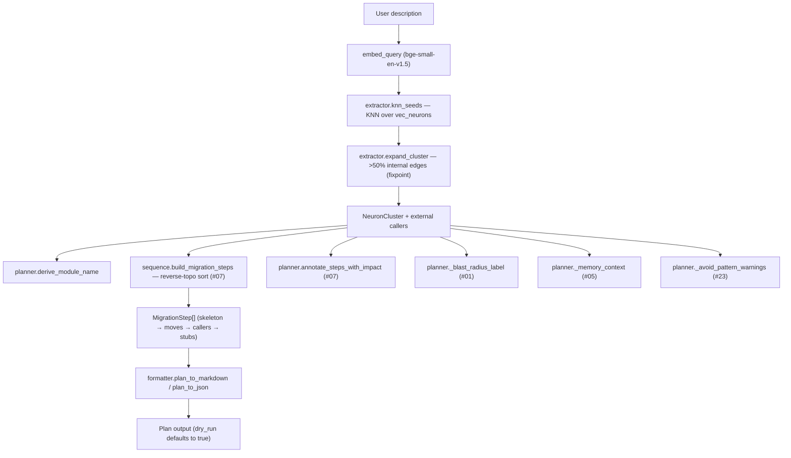

# Cerebrofy — Architecture Guide

This document describes the internal structure, data flow, key invariants, and extension points of Cerebrofy. It is aimed at contributors and anyone who wants to understand how the system works beneath the CLI.

---

## Module Map

```
src/cerebrofy/
├── cli.py                        ← Click command group — registers all sub-commands
│
├── commands/
│   ├── init.py                   ← cerebrofy init: scaffold, hooks, MCP registration
│   ├── build.py                  ← cerebrofy build: 6-step atomic pipeline
│   ├── update.py                 ← cerebrofy update: partial atomic re-index
│   ├── validate.py               ← cerebrofy validate: drift classification
│   ├── arch.py                   ← cerebrofy arch: check/explain/history/init/watch
│   ├── migrate.py                ← cerebrofy migrate: sequential schema migrations
│   ├── mcp.py                    ← cerebrofy mcp: MCP stdio server entry point
│   ├── session.py                ← cerebrofy session: list/show/diff/search/export replays
│   └── plan.py                   ← cerebrofy plan: graph-aware refactor plan (Idea #12)
│
├── parser/
│   ├── engine.py                 ← Tree-sitter runner; dispatches to .scm queries
│   └── neuron.py                 ← Neuron dataclass + ParseResult + deduplicate_neurons
│
├── graph/
│   ├── edges.py                  ← Edge dataclass + rel_type constants
│   └── resolver.py               ← Two-pass name lookup: local + cross-module edges
│
├── embedder/
│   ├── base.py                   ← Embedder ABC: embed(texts) -> list[list[float]]
│   └── local.py                  ← LocalEmbedder (fastembed BAAI/bge-small-en-v1.5, batch 64)
│
├── db/
│   ├── connection.py             ← open_db(): load sqlite-vec + WAL; check_schema_version()
│   ├── schema.py                 ← DDL constants (CREATE TABLE / INDEX / VIRTUAL TABLE)
│   ├── writer.py                 ← write_nodes(), write_edges(), upsert_vectors(), etc.
│   └── lock.py                   ← BuildLock: PID file acquire/release/stale-check
│
├── search/
│   └── hybrid.py                 ← hybrid_search(): KNN + BFS, single read-only connection
│
├── markdown/
│   ├── lobe.py                   ← write_lobe_md(): per-lobe Markdown summary
│   └── map.py                    ← write_map_md(): cerebrofy_map.md
│
├── hooks/
│   └── installer.py              ← install_hooks(), upgrade_hook(), add_gitignore_entry()
│
├── arch/
│   ├── rules.py                  ← Arch rule DSL: parse/validate .cerebrofy/arch-rules.yaml
│   ├── checker.py                ← Rule evaluation engine: graph queries → violations
│   ├── reporter.py               ← Reports: text / markdown / json / GitHub annotations
│   ├── watcher.py                ← cerebrofy arch watch: live monitor + Slack notifications
│   ├── history.py                ← arch-history.jsonl: when each rule was first violated
│   ├── memory.py                 ← arch check --write-memories: violation → warning memory
│   └── ci.py                     ← CI workflow template (init --ai / arch init --ci)
│
├── ignore/
│   └── ruleset.py                ← IgnoreRuleSet (pathspec, gitignore dialect)
│
├── mcp/
│   ├── registrar.py              ← MCP config path detection + idempotent write
│   └── server.py                 ← MCPServer: tool + resource dispatch (27 tools)
│
├── session/                      ← (Idea #11) Live Agent Session Recorder
│   ├── recorder.py               ← sessions + session_events storage; blast-radius tracking
│   ├── replay.py                 ← build_session_diff() — graph delta + risk verdict
│   ├── reporter.py               ← render_markdown() + render_html() replay renderers
│   └── middleware.py             ← SessionMiddleware: thin recorder wired into the MCP dispatcher
├── planning/                     ← Refactor Planner (Idea #12)
    ├── extractor.py              ← KNN seed + cohesive cluster expansion (>50% internal edges)
    ├── sequence.py               ← dependency-safe migration steps (reverse-topo sort)
    ├── formatter.py              ← Markdown + JSON plan output
    └── planner.py                ← pipeline orchestration + feature integrations
│
├── config/
│   └── loader.py                 ← CerebrофyConfig dataclass + YAML I/O
│
├── update/
│   ├── change_detector.py        ← ChangeSet via git diff or hash comparison
│   └── scope_resolver.py         ← UpdateScope via depth-2 BFS from changed nodes
│
├── planning/                     ← Refactor Planner (Idea #12)
│   ├── extractor.py              ← KNN seed + cohesive cluster expansion (>50% internal edges)
│   ├── sequence.py               ← dependency-safe migration steps (reverse-topo sort)
│   ├── formatter.py              ← Markdown + JSON plan output
│   └── planner.py                ← pipeline orchestration + feature integrations
│
├── skills/
│   ├── installer.py              ← install_skills() + install_instructions()
│   └── templates/                ← Bundled SKILL.md + slash-command templates per AI client
│
└── validate/
    └── drift_classifier.py       ← DriftRecord: hash scan → re-parse → Neuron diff
```

---

## Data Flow

### `cerebrofy build`

```
config.yaml + .cerebrofy-ignore
        │
        ▼
   parse_directory()              ← Tree-sitter + .scm queries → list[ParseResult]
        │
        ▼
   write_nodes(conn, neurons)     ← INSERT into nodes table
        │
        ├── resolve_local_edges() → LOCAL_CALL edges
        └── resolve_cross_module_edges() + resolve_import_edges()
                                  → EXTERNAL_CALL, IMPORT, RUNTIME_BOUNDARY edges
        │
        ▼
   write_edges(conn, edges)       ← INSERT into edges table
        │
        ▼
   embedder.embed(texts)          ← list[Neuron] → list[list[float]]
        │
        ▼
   upsert_vectors(conn, ...)      ← INSERT into vec_neurons (sqlite-vec)
        │
        ▼
   build_step5_commit()           ← compute state_hash, write file_hashes, conn.commit()
        │
        ▼
   os.replace(.tmp → .db)         ← ATOMIC SWAP (only on full success)
        │
        ▼
   write_lobe_md() × N            ← per-lobe Markdown (post-swap, fresh conn)
   write_map_md()                 ← cerebrofy_map.md
```

---

## Database Schema

Single file: `.cerebrofy/db/cerebrofy.db`

```sql
-- Named code units (functions, classes, modules)
CREATE TABLE nodes (
  id          TEXT PRIMARY KEY,   -- "{file}::{name}"
  name        TEXT NOT NULL,
  file        TEXT NOT NULL,      -- path relative to repo root
  type        TEXT,               -- "function" | "class" | "module"
  line_start  INTEGER,
  line_end    INTEGER,
  signature   TEXT,
  docstring   TEXT,
  hash        TEXT                -- SHA-256 of the source span
);
CREATE INDEX idx_nodes_file ON nodes(file);
CREATE INDEX idx_nodes_name ON nodes(name);

-- Typed call/import edges between Neurons
CREATE TABLE edges (
  src_id    TEXT REFERENCES nodes(id),
  dst_id    TEXT,
  rel_type  TEXT NOT NULL,        -- LOCAL_CALL | EXTERNAL_CALL | IMPORT | RUNTIME_BOUNDARY
  file      TEXT,
  PRIMARY KEY (src_id, dst_id, rel_type)
);
CREATE INDEX idx_edges_src ON edges(src_id);
CREATE INDEX idx_edges_dst ON edges(dst_id);

-- Key-value metadata
CREATE TABLE meta (
  key    TEXT PRIMARY KEY,
  value  TEXT
);
-- Keys: schema_version, embed_model, embed_dim, state_hash, last_build

-- Per-file content hashes (for drift detection)
CREATE TABLE file_hashes (
  file  TEXT PRIMARY KEY,
  hash  TEXT NOT NULL             -- SHA-256 of file content at last build/update
);

-- sqlite-vec virtual table for KNN search (384-dim for BAAI/bge-small-en-v1.5)
CREATE VIRTUAL TABLE vec_neurons USING vec0(
  id          TEXT PRIMARY KEY,
  embedding   FLOAT[384]
);
```

Every `nodes` row has a corresponding `vec_neurons` row after a completed build (Law III). The `vec_neurons` table cannot be updated in-place — `cerebrofy update` always DELETE+INSERT within the same transaction.

---

## Key Invariants

These rules are architectural constraints. No PR may violate them.

| # | Invariant |
|---|-----------|
| I | `cerebrofy init` MUST NOT create `cerebrofy.db`. The database is created exclusively by `cerebrofy build`. |
| II | All call edges are stored in the `edges` table. `RUNTIME_BOUNDARY` edges are stored but NEVER traversed in BFS. They are collected as `RuntimeBoundaryWarning` items and returned separately. |
| III | Every Neuron in `nodes` MUST have a corresponding row in `vec_neurons` after a completed build. |
| IV | Git hooks start warn-only (v1). Hard-block (v2) activates only after `cerebrofy update` is verified to run in < 2s. |
| V | Zero language-specific logic in `parser/engine.py` or `graph/resolver.py`. All language rules live in `.scm` files. |
| — | `cerebrofy build` writes to `cerebrofy.db.tmp`; swaps via `os.replace()` on success only. |
| — | `cerebrofy update` wraps all DML in `BEGIN IMMEDIATE`. `vec0` does not support UPDATE — always DELETE+INSERT within same transaction. |
| — | Read-only commands (`search/hybrid.py`) open with `?mode=ro` URI and load sqlite-vec manually. |

---

## The Neuron

The `Neuron` is the fundamental unit of the Cerebrofy index:

```python
@dataclass(frozen=True)
class Neuron:
    id: str           # "{file}::{name}" — globally unique
    name: str         # function/class/module name
    type: str         # "function" | "class" | "module"
    file: str         # relative path from repo root
    line_start: int   # 1-based
    line_end: int     # 1-based, inclusive
    signature: str | None
    docstring: str | None
```

Neurons are **immutable value objects** (`frozen=True`). Within a single file, if the same `id` appears more than once, only the first occurrence by `line_start` is kept (`deduplicate_neurons()`). Anonymous functions (lambdas, arrow functions) are never captured.

---

## Edge Types

| Type | Meaning |
|------|---------|
| `LOCAL_CALL` | Function call resolved within the same file |
| `EXTERNAL_CALL` | Function call resolved to another file via the name registry |
| `IMPORT` | Import statement resolved to the imported module's Neurons |
| `RUNTIME_BOUNDARY` | Unresolvable cross-language or dynamic call — stored but never traversed in BFS |

`RUNTIME_BOUNDARY` edges are collected as `RuntimeBoundaryWarning` objects during hybrid search and returned separately — they are never included in blast-radius counts.

---

## Hybrid Search

`hybrid_search()` in `search/hybrid.py` combines two strategies over a single read-only SQLite connection:

1. **KNN search** — `vec_neurons` cosine similarity query via `vec_f32() MATCH`, returns `top_k` `MatchedNeuron` objects ordered by similarity descending
2. **BFS expansion** — depth-2 BFS from each matched Neuron, collecting `MatchedNeuron` objects for each structural neighbor (excludes `RUNTIME_BOUNDARY` edges)
3. **Lobe resolution** — derives affected lobe names by matching file paths against `config.lobes`

```
similarity = max(0.0, 1.0 - cosine_distance)
```

The connection is opened with `?mode=ro` (read-only). sqlite-vec is loaded manually on the connection — `open_db()` is not used here because it sets WAL pragma, which is incompatible with `?mode=ro`.

**Public API:**

```python
embedding = embed_query(query, config.embedding_model)   # embed BEFORE opening DB
result = hybrid_search(
    query=query,
    db_path=db_path,
    embedding=embedding,
    top_k=10,
    lobes=config.lobes,
    repo_root=root,
)
# result.matched_neurons  — KNN hits, sorted by similarity desc
# result.blast_radius     — BFS neighbors (similarity = 0.0)
# result.runtime_boundary_warnings — RUNTIME_BOUNDARY edges encountered
# result.affected_lobes   — sorted lobe names from all neurons
```

---

## Refactor Planner (Idea #12)

`cerebrofy plan` turns a plain-English refactoring description into a graph-aware, dependency-safe migration plan. The planner is a pure planning layer — it reads the index and emits a plan; it **never writes source files**. Execution is an explicit handoff (`--execute`) to an AI agent, verified per-step with `cerebrofy impact`.

**Pipeline:** `extractor` → `sequence` → `formatter`.



**Modules** (`src/cerebrofy/planning/`):

| Module | Responsibility |
|--------|---------------|
| `extractor.py` | KNN seed reused from `search/hybrid.py` + fixpoint cluster expansion (neighbors with >50% internal edges join). `RUNTIME_BOUNDARY` edges are never traversed (Law II). |
| `sequence.py` | Dependency-safe migration ordering, reusing the reverse-topological sort from `analysis/sequence.py` (#07). Every neuron appears in at most one step — ordering can never be circular. |
| `formatter.py` | Emits the exact spec JSON schema (`cluster`, `proposed_structure`, `callers_to_update`, `steps`, `estimated_hours`, `files_affected`) plus a human-reviewable Markdown checklist. |
| `planner.py` | Orchestrates the pipeline and wires integrations: #01 blast radius (risk label), #05 agent memory (plan context), #07 impact (per-step prediction), #23 product intent (`avoid_patterns`). Each degrades gracefully when its data is absent. |

**Entry points:** `commands/plan.py` (`cerebrofy plan`) and `mcp/tools/plan.py` (`cerebrofy_plan`), registered additively in `cli.py` and `mcp/server.py`.

**Integrations deferred to later ideas** (marked with `TODO(integration-N)`, not wired on this branch):
- #11 — record plan execution as a session
- #17 — post-execution review copilot
- #24 — synthesized-pattern avoidance for historically-failing steps

**Acceptance targets:** plan generation < 10s; sequencing never circular; caller-update list complete (asserted by deterministic fixture-graph unit tests).

---

## Git Hook Lifecycle

```
cerebrofy init
    └── install pre-push hook (version 1, warn-only)
            # BEGIN cerebrofy
            # cerebrofy-hook-version: 1
            cerebrofy validate --hook pre-push
            # END cerebrofy

cerebrofy update  (completes in < 2s)
    └── upgrade_hook() → version 2 (hard-block, idempotent)
            # BEGIN cerebrofy
            # cerebrofy-hook-version: 2
            if ! cerebrofy validate --hook pre-push; then
                echo 'Cerebrofy: Structural drift detected. Run cerebrofy update to sync.'
                exit 1
            fi
            # END cerebrofy

.cerebrofy/arch-rules.yaml exists  (scaffolded by init, extended by arch init)
    └── upgrade_hook() → version 4 (validate section + blocking arch section)
            # BEGIN cerebrofy
            # cerebrofy-hook-version: 4
            <validate section: warn-only or hard-block, per .cerebrofy/ gitignore state>
            if [ -f ".cerebrofy/arch-rules.yaml" ]; then
                if ! cerebrofy arch check --hook pre-push; then
                    echo 'Cerebrofy: Architecture violations detected. Push blocked.' >&2
                    exit 1
                fi
            fi
            # END cerebrofy
```

The sentinel format `# BEGIN cerebrofy` / `# cerebrofy-hook-version: N` / `# END cerebrofy` allows `upgrade_hook()` to locate and replace exactly the Cerebrofy block without disturbing any pre-existing hook logic. v4 is upgrade-only and always hard-blocks on architecture violations — the gitignore consent model applies to the validate section only. Removing the rules file disarms the arch segment at runtime; it never downgrades an installed hook.

---

## MCP Dispatcher

The MCP server (`mcp/server.py`) uses **CWD routing**: at each tool invocation it calls `os.getcwd()` and walks up the directory tree looking for `.cerebrofy/config.yaml`. A single registered MCP server entry (`mcpServers.cerebrofy`) serves all repos on the machine — no per-repo registration needed.

```
AI calls search_code(query="rate limiting middleware")
    │
    ▼
run_mcp_server() → call_tool("search_code", {"query": "..."})
    │
    ▼
_find_repo_root(Path.cwd())       ← reads CWD at call time
    │
    ▼
load_config(root / ".cerebrofy/config.yaml")
    │
    ▼
embed_query(query, config.embedding_model)
    │
    ▼
hybrid_search(query, db_path, embedding, ...)
    │
    ▼
returns TextContent(type="text", text=<json ranked results>)
```

---

## Session Recorder (Idea #11)

The **Live Agent Session Recorder** captures every MCP tool call of an agent session as a structured, local-only replay: which neurons were touched, in what order, what changed in the call graph, and how the blast radius (Idea #01) moved. Recording is **opt-in** (`record_sessions: true` in `.cerebrofy/config.yaml`) and **zero-impact** on tools that run without it.

Storage is split from the index for the same reason `memories.db` (#05) is split from `cerebrofy.db`: the index is rebuilt atomically by `cerebrofy build` and written under `BEGIN IMMEDIATE` by `cerebrofy update`, while the audit trail must survive rebuilds and never contend with the index writer.

- `session/recorder.py` — `sessions` + `session_events` tables in `.cerefy/db/sessions.db`; `start_session`, `record_event`, `end_session`, `search_sessions`. Argument/result payloads are truncated so storage stays well under 1 MB/hour.
- `session/middleware.py` — thin `SessionMiddleware` with a module-level `record_tool_call()` hook; recording only fires when opt-in is enabled and a session is active, and never raises.
- `session/replay.py` — `build_session_diff()` computes the graph delta (touched / missing / appeared / index-refreshed) and a blast-radius verdict.
- `session/reporter.py` — self-contained Markdown + HTML renderers for `cerebrofy session show/export`.
- `mcp/tools/session.py` — `cerebrofy_session_start` / `cerebrofy_session_end` / `cerebrofy_session_show` handlers.

### Recording flow

```mermaid
flowchart TD
    A[AI agent starts a coding task] --> B{record_sessions<br/>enabled in config?}
    B -- yes --> C[cerebrofy_session_start&#40;task, agent&#41;<br/>INSERT sessions row → sess_id]
    B -- no --> D[tools run normally<br/>no recording]
    C --> E[MCP dispatcher wraps every tool call<br/>call_tool → SessionMiddleware.record]
    E --> F[record_event&#40;sessions.db&#41;<br/>args/result truncated < 1KB]
    F --> G[resolve_neuron_refs&#40;&#41; + depth-2<br/>blast-radius lookup into cerebrofy.db<br/>captured once per neuron]
    G --> E
    E --> H[cerebrofy_session_end&#40;outcome, summary&#41;<br/>ends session + blast_radius_after + outcome]
    H --> I[sessions.db: closed session]
    I --> J[cerebrofy session show/show/diff/export<br/>replay_session + build_session_diff<br/>+ render_markdown&#40;&#41; / render_html&#40;&#41;]
    style D fill:#f6f8fa,stroke:#e1e4e8
    style J fill:#f6f8fa,stroke:#e1e4e8
```



The `SessionMiddleware.record()` path is bounded for latency: one indexed `INSERT` per tool call plus a single depth-2 blast-radius lookup per *new* neuron referenced (capped at `MAX_TRACKED_NEURONS = 50`). The `cerebrofy_session_start/end/show` tools are deliberately excluded from recording so they never appear nested inside their own session.

### Database layout

`cerebrofy.db` (schema version 1, rebuilt by `cerebrofy build`) and `sessions.db` / `memories.db` are peer local databases under `.cerebrofy/db/`. Session recording reads `cerebrofy.db` in read-only mode (`?mode=ro`) for blast-radius lookups and writes only to `sessions.db`.

## Adding Language Support

Cerebrofy is designed so that new language support requires zero changes to the Python engine. You only need to provide a Tree-sitter `.scm` query file.

### Steps

1. Verify the language is in `EXTENSION_TO_LANGUAGE` in `parser/engine.py`. If not, open a PR to add the extension mapping.

2. Create `.cerebrofy/queries/<lang>.scm` (or install it into `src/cerebrofy/queries/` for bundled support).

3. The query file must capture these node names:

| Capture name | Meaning |
|--------------|---------|
| `definition.name` | Name node of a function/method/class definition |
| `definition.node` | The full definition node (for extracting line range) |
| `call.name` | Name node of a function call expression |
| `import.path` | The module path being imported |

4. Add the extension to `tracked_extensions` in `.cerebrofy/config.yaml`.

5. Run `cerebrofy build` to index the new language.

### Example (Python fragment)

```scheme
; Capture function definitions
(function_definition
  name: (identifier) @definition.name) @definition.node

; Capture class definitions
(class_definition
  name: (identifier) @definition.name) @definition.node

; Capture call expressions
(call
  function: (identifier) @call.name)

; Capture imports
(import_from_statement
  module_name: (dotted_name) @import.path)
```

---

## Testing

```bash
# All tests
uv run pytest

# Unit tests only (fast, no filesystem)
uv run pytest tests/unit/

# Integration tests (use tmp_path, build real cerebrofy.db)
uv run pytest tests/integration/
```

Integration tests use `pytest`'s `tmp_path` fixture exclusively — they never touch the real filesystem outside `tmp_path`. No mocking of the database; tests build a real `cerebrofy.db` in a temporary directory.
